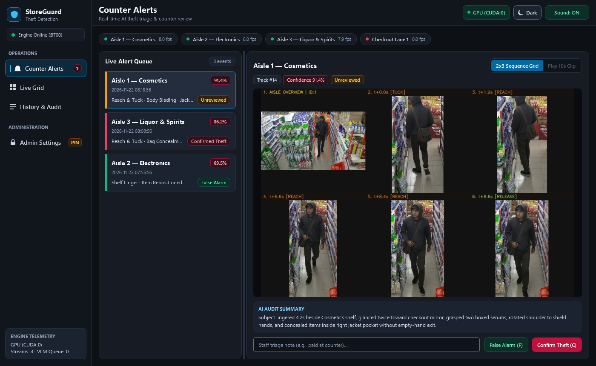
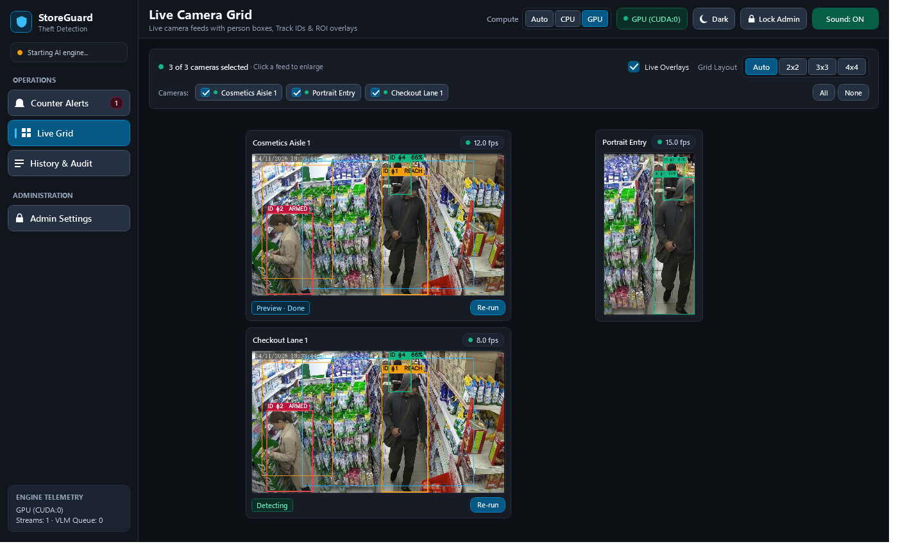
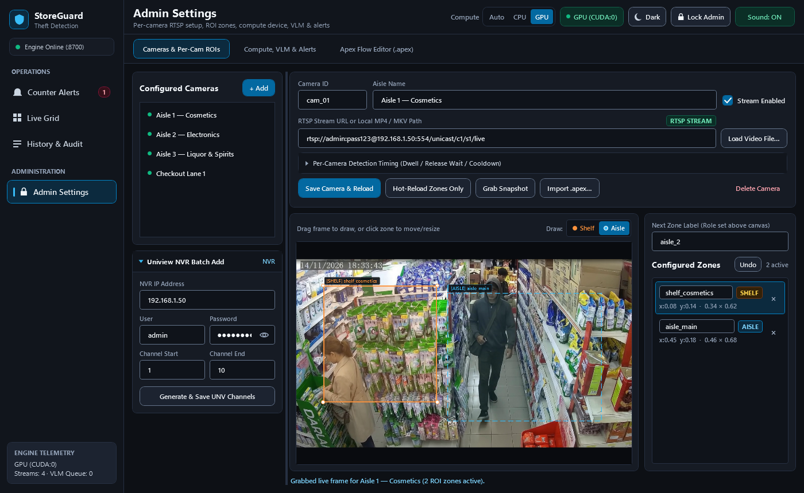

# StoreGuard — Multi-Stream CCTV Retail Theft Detection System

StoreGuard pairs a **headless Python multi-stream AI engine** (`ai_engine/`, powered natively by the **Apex Vision SDK Runtime** `ApexRuntimeEngine`) with a **C# .NET 8 WPF counter & owner desktop application** (`StoreGuard.Desktop`).

Each camera stream executes as an independent `<ApexFlow>` procedure (`Image Source → ROI Zone Manager → Motion Gate → YOLO Pose → Context Object Detector → BoT-SORT Tracker → Behavior Gate → Async Cloud/Local VLM`) with cross-camera dynamic ONNX micro-batching and 10-second MP4 evidence clip recording.

---

## Screenshots

### Counter Alerts — Real-Time AI Theft Triage & 2×3 Sequence Evidence


### Live Camera Grid — Multi-Stream Matrix & Per-Layer Overlays


### Admin Settings — Per-Camera RTSP Setup & Interactive ROI Canvas Editor


---

## Key Features

- **Apex Vision SDK Core Runtime:** Every camera executes through `apex_vision.sdk.ApexRuntimeEngine` (`runtime_data/storeguard.apex`), using shared ONNX Runtime sessions (`models/yolo11n-pose.onnx` + `models/yolo11n.onnx`) and dynamic micro-batching across streams.
- **Per-Layer Live Grid Overlays & TrueType Badges:** Toggle individual overlay layers live in the WPF Live Grid (**Shelf**, **Aisle**, **Pose** 17-keypoint skeleton, **BoT-SORT** track ID/phase/trails, **Bags** context objects, and **Motion** ROI) rendered with cached anti-aliased `Segoe UI Semibold` pill badges.
- **Dual-Trigger Behavioral State Machine & VLM Verification:** Tracks shelf reach, concealment/tuck, and cross-camera pickup events before dispatching a 2×3 visual sequence grid or native MP4 clip to the configured VLM (`Gemini`, `OpenAI`, `OpenRouter`, `Ollama`, or `LM Studio`).
- **Counter Dashboard & Owner Administration:**
  - **Staff Counter View:** Real-time theft alert cards, synchronized MP4 evidence video player, 2×3 sequence grid viewer, and 1-click *Confirm Theft* / *False Alarm* disposition.
  - **Live Camera Matrix:** Auto / 2×2 / 3×3 / 4×4 grid layouts, per-camera visibility chips, click-to-focus HD view, and per-layer overlay toggles.
  - **Admin Settings (PIN-protected, default `1234`):** Interactive ROI Canvas Editor (`Shelf` & `Aisle` zones with Undo), Uniview NVR batch channel generator, compute device & VLM configuration, and embedded **Apex Flow Editor** with bidirectional `.apex` XML sync.

---

## Repository Layout & Prerequisites

StoreGuard automatically resolves the `apex_vision` SDK from a sibling **`ApexVision`** folder (or via the `APEX_VISION_PATH` environment variable):

```text
<ParentFolder>/
  ├── ApexVision/     # Apex Industrial Vision Studio & SDK (apex_vision/, plugins/theft_recognition_plugin/)
  └── StoreGuard/     # StoreGuard WPF Desktop App + FastAPI AI Engine wrapper
```

### Requirements
- **Windows 10 / 11 (x64)**
- **.NET 8.0 SDK / Desktop Runtime**
- **Python 3.11 or 3.12 (64-bit)**

---

## Quick Start

### 1. Python Dependencies
```powershell
cd StoreGuard
pip install -r requirements.txt

# On NVIDIA CUDA machines, replace CPU onnxruntime with onnxruntime-gpu:
pip uninstall -y onnxruntime
pip install onnxruntime-gpu
```

### 2. Configure Cameras (`runtime_data/cameras.json`)
Copy the template if starting fresh:
```powershell
Copy-Item runtime_data\cameras.example.json runtime_data\cameras.json
```
*(Or configure cameras, ROI zones, and your VLM API key directly inside the app under **Admin Settings**, default PIN: **`1234`**.)*

- **Uniview (UNV) NVR RTSP format:**
  - Main stream: `rtsp://<user>:<password>@<nvr-ip>:554/unicast/c<channel>/s0/live`
  - Sub-stream (`s1`, recommended for Live Grid tiles): `rtsp://<user>:<password>@<nvr-ip>:554/unicast/c<channel>/s1/live`

### 3. Build & Launch
```powershell
# Build Release binaries
dotnet build StoreGuard.sln -c Release

# Launch StoreGuard (starts both the desktop app and the headless AI engine on 127.0.0.1:8700)
.\Launch_StoreGuard.bat
```

---

## Running Tests

```powershell
# Python AI Engine & Apex Vision SDK integration tests (28 tests)
python -m pytest tests/ai_engine_tests -q

# C# .NET 8 unit & WPF layout/overflow tests (26 tests)
dotnet test StoreGuard.sln -c Release
```
